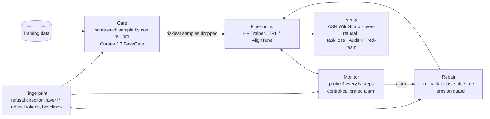

# Brink

[](https://github.com/andrew1234-arch/brink/actions/workflows/ci.yml)


**Brink stops fine-tuning from breaking a model's safety.** It drops the training data that would erode the
model's refusals, watches the refusals while the model trains, and rolls training back as soon as they start to
slip.

Fine-tune a safe chat model, even on mostly harmless data, and it can quietly stop refusing harmful requests.
Today you only find out afterwards, with an expensive evaluation, and then repair the damage. Brink works
*during* training instead:

1. **Before training:** it scores every training sample and removes the ones that would erode safety, including
   harmless-looking ones a content filter lets through.
2. **While training:** every few steps it measures how strongly the model leans towards refusing a fixed set
   of probe prompts, and raises an alarm when that drops, with a threshold calibrated on safe fine-tuning runs
   so they don't trip it.
3. **On the alarm:** it rolls the model back to its last safe state and keeps training with a guard that blocks
   further erosion, so the model still learns its task.
4. **After training:** it verifies the result on held-out harmful and harmless prompts, task skill and
   red-team probes.

Add it to an existing Hugging Face / TRL / AlignTune training run with one callback:

```python
trainer = SFTTrainer(model=model, args=args, train_dataset=ds, callbacks=[BrinkCallback(controller=controller)])
```

Built on Cohere's **Tiny Aya** with the **Lexsi Labs** open-source stack (CuratorKIT, AlignTune, SafeTune,
AuditKIT) and **Hugging Face**, for the Lexsi AI Safety & Alignment Hackathon 2026.

---

## How it works

Brink measures one quantity, **J**: the model's preference to refuse rather than comply on a fixed set of
probe prompts, relative to a *fingerprint* of the model taken before fine-tuning. J does three jobs:



| Stage | What Brink does | Why it holds up |
|---|---|---|
| **Before training** | The **gate** scores each sample by the first-order change in J that one SGD step on it would cause | The predicted change matches a real SGD step to three significant figures (tested) |
| **During training** | The **monitor** probes J in one forward pass every few steps and raises an alarm | The threshold is calibrated only on safe fine-tuning; false alarms are tested leave-one-seed-out |
| **On alarm** | **Rollback** to the last safe LoRA state, then the **erosion guard** removes the part of each gradient that would lower J | A guarded step leaves J unchanged to first order while removing only 4–35 % of the gradient (tested) |
| **After training** | **Verify** on safety, over-refusal, task skill and red-team probes | Compared against safety-data mixing, a content-filter gate, ReSta and steering |

Refusal-direction drift and safety-aware data filtering are established in prior work. Brink claims the
**integrated, honestly evaluated system**, not those observations. See
[docs/RELATED_WORK.md](docs/RELATED_WORK.md).

## Quickstart

```bash
pip install -e ".[judge,dashboard,dev]"
```

```bash
make test        # offline CPU test suite: tiny random models, nothing downloaded
```

```bash
make app         # the app: run Brink end to end on a real model, gate your own data, browse the experiments
```

### See it work end to end

The app's **Run Brink** tab runs the whole product live on a real model: it fingerprints the model, gates a
contaminated fine-tuning set, fine-tunes twice on it (unprotected, and with Brink's alarm and repair), and
verifies both on held-out harmful and harmless prompts, with a plain-language verdict. Tiny Aya on a GPU; a
0.5B model on CPU. **Gate your data** scores any fine-tuning file you upload and hands back a cleaned file.
See [docs/DASHBOARD.md](docs/DASHBOARD.md). `make live` records the same run headless.

### Use it in your own fine-tuning

```python
from brink.monitor.callback import BrinkCallback
from brink.monitor.core import Monitor
from brink.probe import Prober, calibrate
from brink.repair import ErosionGuard, RepairController

# 1. Fingerprint the model before fine-tuning (harmful / harmless prompt lists: calibration and probe splits).
fp, _ = calibrate(model, tok, harmful_cal, harmless_cal, harmful_probe, harmless_probe)

# 2. Monitor + alarm + repair policy.
monitor = Monitor(
    Prober(fp, tok, harmful_probe, harmless_probe),
    "runs/my-finetune",
    probe_every=4,
    alarm_signal="S3",
    alarm_threshold=-3.0,
)  # use the control-calibrated threshold
controller = RepairController(monitor, "rollback_guard", guard=ErosionGuard(tok, fp, harmful_probe, harmless_probe))

# 3. Attach to any Hugging Face Trainer or TRL SFTTrainer.
trainer = SFTTrainer(model=model, args=args, train_dataset=ds, callbacks=[BrinkCallback(controller=controller)])
trainer.train()
```

- **AlignTune:** `attach_to_aligntune(aligntune_trainer, BrinkCallback(controller=...))`.
- **CuratorKIT:** add `BrinkSafetyGate(GateScorer(...), drop_frac=0.05)` as a step in a `curatorkit.Pipeline`.

## Experiments

| # | Experiment | Question |
|---|---|---|
| 00 | [go / no-go](docs/GO_NOGO.md) | Does the alarm fire before behaviour breaks, without false alarms on safe fine-tuning? (2 seeds) |
| 01 | [data gate](docs/GATE.md) | Does the gate find the data that erodes safety, including benign data a content filter misses? |
| 02 | [repair](docs/REPAIR.md) | Does rollback + erosion guard beat safety-data mixing, ReSta and steering? |
| 03 | [multilingual](docs/MULTILINGUAL.md) | Does English fine-tuning erode safety in Hindi and Tagalog, and does English-only monitoring miss it? |
| 04 | [pipeline](docs/PIPELINE.md) | Does the full Lexsi pipeline deliver a safe, useful Hindi assistant from contaminated data? |
| live | [end to end](docs/DASHBOARD.md#run-brink-end-to-end-live) | The whole product on Tiny Aya in one run: gate, monitor, repair, verify (recorded for the Space) |
| circuit | [CircuitKIT](docs/CIRCUIT.md) | Does CircuitKIT's refusal circuit sit where Brink reads refusal? (experimental) |

**Run everything:**
- **Kaggle:** [`notebooks/kaggle_run_all.ipynb`](notebooks/kaggle_run_all.ipynb). It saves results after
  every stage and resumes across sessions.
- **Any GPU machine:** `make run-all`. About 13 h on a T4 x2 in total.

Each experiment writes a `REPORT.md` with an explicit verdict, and the dashboard reads every run.

**Results so far** (Tiny Aya on a Kaggle T4; the full write-up is [docs/ARTICLE.md](docs/ARTICLE.md)):

- **End to end (recorded live run, 1 seed):** fine-tuning on 128 samples, 32 of them harmful, took the model
  from answering 21 % of held-out harmful prompts to **94 %** (it refused only 4 %). The same fine-tune with Brink
  ended at **21 %**, where it started, with no over-refusal and the same task loss (1.462 vs 1.452 unprotected;
  2.016 before fine-tuning). Brink's gate removed 29 of the 32 harmful samples (91 % of what it dropped, against 25 %
  for random dropping); the 3 that slipped through didn't trip the alarm, so rollback and the guard weren't needed.
  On the unprotected run the alarm fired at step 20.

- **The alarm (00, 2 seeds):** caught both harmful fine-tunes and never fired on the 2 safe ones (threshold
  calibrated leave-one-seed-out). It is confirmed at step 8, the first evaluation at which refusals have broken
  (ASR 16 % → 36–38 %, ending at 97–100 %), and 4 steps before a cheap judge checking at every probe step. The
  signal is already at −12σ at step 4. The verdict is **NO-GO** on one of four pre-set checks: the signal tracks
  ASR only while ASR is rising (rank correlation −1.0 to step 24, −0.38 / −0.62 over the whole run), so it is an
  alarm, not a gauge. The internal-activation signals also drop on safe fine-tuning and detect nothing once
  calibrated: the claim is an early warning, not mechanistic foresight.
- **Languages (03):** English, Hindi and Tagalog each break under harmful fine-tuning, and each language's own
  alarm catches its break (Tagalog's 4 steps early). On safe fine-tuning the Hindi and Tagalog alarms fire
  falsely at step 20, so the non-English alarm needs its own calibration.
- **The Hindi assistant (04, the full Lexsi pipeline):** fine-tuning on 512 Hindi instruction pairs, 51 of them
  harmful, raised English attack success from 16 % to **42 %**. With Brink (CuratorKIT gate, then AlignTune
  training with alarm, rollback and guard) it ended at **6 %**, with no over-refusal and the same task loss
  (1.800 vs 1.788; 2.102 before). All four pre-set checks pass. Hindi attack success stayed at 0–2 % in every
  model, so this run shows no Hindi erosion to prevent.
- **Gate (01):** it ranks planted harmful samples at the top (AUROC 0.981; 86 % of them in the top 5 %). On
  benign data the predicted ordering holds (fine-tuning on the top-scored subset ends at 19 % attack success,
  random 11 %, bottom 9 %), but the gap is 8 points and the pre-set check asked for 10: **not proven**.
- **Repair (02):** without repair the model ends at 83 % attack success. Halting at Brink's alarm keeps it at
  **17 %**. Rollback + guard, trained to the end, ends at 41 %: worse than safety-data mixing (23 %) and
  steering (19 %), so the claim that it beats the standard fixes is **not proven**.

## The Lexsi stack in Brink

Hackathon entry: **Track 2b (AI Safety and Correction)**, problem statement **#5 Safety-preserving fine-tuning**,
also #9 (locating where safety lives) and 2a #4 (multilingual safety). Write-up: [docs/ARTICLE.md](docs/ARTICLE.md).

| Toolkit | Role |
|---|---|
| **CuratorKIT** | `BrinkSafetyGate`, a native `BaseGate`. *Run Brink* and the pipeline experiment gate data through a CuratorKIT pipeline (`ExactDeduplicator` → `BrinkSafetyGate`) |
| **AuditKIT** | Red-team probes on the base model and every final model, in *Run Brink* and the experiments; attack resistance and over-refusal reported separately |
| **SafeTune** | The repair baselines Brink is measured against: ReSta, and steering along the fingerprint's pre-drift direction |
| **CircuitKIT** | Discovers Tiny Aya's refusal circuit; checks that Brink monitors the layer the circuit writes into; its `safety_units` are SafeTune-readable |
| **AlignTune** (Track 1) | Training in the pipeline experiment, with Brink attached through its TRL backend |

Issues found while integrating are written up in [docs/UPSTREAM.md](docs/UPSTREAM.md).

## Responsible release

Brink deliberately trains models whose safety breaks, in order to study that. So:
- Model replies to harmful prompts are never committed or published.
- Deliberately drifted adapters are never published; the release script refuses them.
- The dashboard shows rates and labels only.

Published: fingerprints, results, and Brink-protected adapters.

## Documentation

- [Architecture](docs/ARCHITECTURE.md): components, design decisions, repository layout.
- [Related work](docs/RELATED_WORK.md): prior work, and what Brink does and doesn't claim.
- [The app](docs/DASHBOARD.md): Run Brink live, Gate your data, the experiment dashboard, the Space.
- [Write-up](docs/ARTICLE.md): approach, datasets, metrics, results and limitations.
- [Upstream feedback](docs/UPSTREAM.md): for the Lexsi toolkits.

## Development

```bash
make install-all   # + CuratorKIT, AuditKIT, SafeTune (Python >= 3.12), AlignTune
```

```bash
make lint          # ruff check + format check (CI runs this and the tests on every push)
```

## Citation

See [CITATION.cff](CITATION.cff).

## License and acknowledgements

MIT ([LICENSE](LICENSE)). The Lexsi toolkits Brink integrates with carry their own licences: AlignTune is MIT;
CuratorKIT, SafeTune and AuditKIT are LSAL source-available.

Thanks to Lexsi Labs for the toolkits, Cohere Labs for Tiny Aya and the Aya datasets, and Hugging Face. Datasets:
AdvBench, HarmBench, Alpaca, LLM-LAT harmful-dataset, Aya red-teaming, Aya dataset. Judge: WildGuard.
