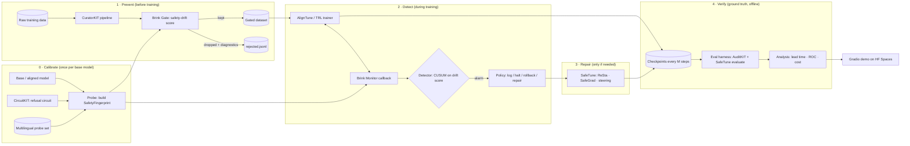

# Brink — Architecture

> Detect and prevent LLM safety collapse **during** fine-tuning, before behavioural evals can see it.

## 1. Thesis (what we must prove)

1. **Predictable:** a cheap mechanistic signal (refusal direction / refusal circuit) moves *before*
   behavioural safety metrics (HarmBench attack success rate) degrade during fine-tuning.
2. **Preventable:** the same signal, applied to training data *before* fine-tuning, identifies the
   benign-looking samples that cause drift. Removing them keeps task performance and most of the safety.
3. **Cheaper than repair:** gate + monitor beats post-hoc repair (ReSta, SafeGrad) on the
   safety / capability / compute trade-off.
4. **Multilingual (Aya angle):** drift shows up earlier or harder outside English, and Brink catches it
   where English-only evals don't.

Every component below exists to produce evidence for one of these four claims.

## 2. System overview



## 3. Components

### 3.0 `brink.probe`: the shared measurement core
Everything else depends on this, so it has to be fast, deterministic and work on a **live `nn.Module`**
(for the in-training callback) as well as a **checkpoint path** (for offline analysis).

**SafetyFingerprint** (built once from the base model, saved to the Hub):
- refusal direction `r̂_ℓ` per layer = normalized diff-in-means of last-token residuals, harmful vs harmless
  prompts (per language and pooled);
- chosen layer `ℓ*` (max separation on a held-out split; never picked automatically at runtime);
- refusal circuit components from CircuitKIT, mapped to HF module names (see §5, decision D2);
- baseline mean / std of every signal on the base model, per language.

**Signals** (computed on a fixed probe set, about 64 harmful + 64 harmless prompts per language):

| ID | Signal | Cost | What it catches |
|---|---|---|---|
| S1 | Mean projection of harmful-prompt activations on `r̂_ℓ*` | 1 forward pass | Refusal representation weakening |
| S2 | Cosine(current diff-in-means direction, base `r̂`) | same pass | Refusal direction rotating away |
| S3 | Refusal-vs-compliance first-token logit gap on harmful prompts | same pass | Behaviour about to flip, no generation needed |
| S4 | Activation / attribution mass on refusal-circuit components | hooks, same pass | Circuit being dismantled |
| S5 | Over-refusal guard: S3 on harmless prompts | same pass | Monitor not just rewarding "refuse everything" |

All five come from **one batched forward pass with hooks**, about 1–3 s on a T4 for Tiny Aya. That is
the cost story: a HarmBench run needs generation plus a 7B judge.

**Probe-set hygiene:** probe prompts are disjoint from every evaluation prompt (HarmBench, AuditKIT
red-team). Otherwise the "lead time" claim is contaminated.

### 3.1 `brink.gate`: prevention, before training
Scores each training sample by **predicted refusal erosion**: the first-order change in the monitor's own
objective J (S3 and/or S1 on the harmful probe set) caused by one SGD step on that sample:
`score(x) = cos(∇_LoRA L(x), ∇_LoRA J)`, using fresh LoRA adapters as a random projection of the full
gradient (as in LESS). The gate and the monitor therefore measure the same thing, before and during
training. Baselines: representation similarity to unsafe vs safe anchors (He et al. 2024), and random.

Policy: drop the top-k % or everything above a threshold. It is packaged as a **CuratorKIT `BaseGate`**
(`brink.gate.curatorkit_gate.BrinkSafetyGate`): rejected samples go to CuratorKIT's `rejected.jsonl`, and
provenance records carry the score and rank. Details and the experiment: [GATE.md](GATE.md).

### 3.2 `brink.monitor`: detection, during training
- A standard `transformers.TrainerCallback`, so it works under AlignTune's TRL backend, plain TRL and
  SafeTune's trainers without depending on AlignTune internals.
- Every `N` steps, on the live LoRA model (no reload): run the probe, then compute the drift score
  `D_t = Σ w_i · z_i(t)`, a z-score of each signal vs base stats, per language, worst language wins.
- **Detector:** one-sided CUSUM on `D_t`, so a single noisy step can't fire it. The threshold is
  calibrated on **negative-control runs** (safe data) to a fixed false-alarm rate (target ≤ 5 %).
- **Policies on alarm:** `log` (study mode) · `halt` · `rollback` to last safe checkpoint ·
  `repair` (hand off to `brink.repair`) · `harden` (resume with SafeGrad).
- Logs every signal to JSONL plus trackio / W&B, so the demo dashboard can replay any run.

### 3.3 `brink.repair`: thin adapters over SafeTune
- **ReSta** (weight-space, no training; needs base + aligned + drifted).
- **SafeGrad / LISA** (train-time hardening, used by the `harden` policy).
- **Refusal-direction steering** (inference-time, no weight change; serves as a baseline).

Brink doesn't invent repair methods. It decides *when* to repair, and lets us compare
"prevent early" vs "repair late".

### 3.4 `brink.eval`: ground truth, offline
Runs on dense checkpoints (every `M` steps) to build the behavioural curve the monitor is judged against.
- **Safety:** HarmBench ASR (SafeTune `evaluate`, WildGuard judge) plus AuditKIT red-team
  (jailbreak, injection, encoding), per language.
- **Over-refusal:** AuditKIT over-refusal probes. A safe-but-useless model is a failure.
- **Capability:** the fine-tuning task's own metric plus a small lm-eval subset.
- **Stats:** bootstrap CIs and significance tests via AuditKIT; 3 seeds per condition.

### 3.5 `brink.analysis`
- **Lead time:** `t_behav` = first checkpoint where ASR > base + δ (CI excludes base); `t_alarm` = first
  CUSUM alarm; `lead = t_behav − t_alarm` (steps and GPU-minutes).
- Detection ROC across positive (drift) and negative (control) runs; false-alarm rate.
- Spearman correlation of each signal vs ASR across checkpoints (the "judge-free proxy" fallback claim).
- Cost: GPU-seconds per probe vs per HarmBench eval.
- Pareto plot: safety vs capability vs compute for every condition.

### 3.6 `app/`: monitor dashboard (Gradio, HF Spaces)
Built: see [DASHBOARD.md](DASHBOARD.md). It reads any run folder (finished, or still being written) and
recomputes the alarm from the logs with an adjustable rule (signal, z threshold, persistence, CUSUM). It shows
status, alarm vs behaviour-break step and lead time, probe-vs-eval cost, the signal curves, the ASR ground
truth, per-layer erosion, and the gate results. Live mode follows a run as it trains, e.g. from a Kaggle
notebook with a public share link. It needs no ML stack, so it runs on a free CPU Space. Still to do: a
side-by-side chat with the drifted vs protected model, which needs a GPU.

## 4. Experiment matrix

| Axis | Values |
|---|---|
| Model | **Tiny Aya** (primary) · Command R7B or Aya Expanse 8B (generalization, if compute allows) |
| Fine-tuning data | **EM** (emergent-misalignment sets: bad medical / risky financial advice, insecure code) → strong drift · **Benign** (real task data) → mild drift · **Control** (benign + safety data) → no drift · **Harmful-small** (about 100 explicit examples) → fast drift, stress test |
| Condition | Baseline FT · FT + Gate · FT + Monitor(halt) · FT + Monitor(repair) · FT → ReSta (post-hoc) · SafeGrad (hardened) |
| Language | EN · HI (high-resource; AI Safety India is an outreach partner) · one low-resource (e.g. SW or YO) |
| Seeds | 3 |

The full grid is too big for our time and compute. We run it **in priority order**: EM + Control on
Tiny Aya, EN first, then the Gate, then the multilingual slice, then the second model.

## 5. Key design decisions

| # | Decision | Why |
|---|---|---|
| D1 | Monitor core is framework-agnostic (`monitor(model, step)`), with a thin `TrainerCallback` adapter; signals use plain PyTorch, not toolkit internals | Toolkits are young (AgentTune has 5 commits; open PRs everywhere). Brink must not break when they do. The go / no-go uses its own loop because HF Trainer would DataParallel across both Kaggle GPUs, and GPU 1 is the judge's. |
| D2 | CircuitKIT runs **offline, once**, on the base model; components are mapped to HF module names for hooking | CircuitKIT uses TransformerLens, which is too heavy for in-loop use, and Aya support is experimental. |
| D3 | **Two Python envs** if needed: `train` (AlignTune / SafeTune / CuratorKIT / AuditKIT) and `circuits` (CircuitKIT) | CircuitKIT pins transformers 5 + transformer-lens 3.8.0, and AlignTune's vendored Unsloth caps transformers. They likely conflict. |
| D4 | Core: Python ≥ 3.10 (runs on Kaggle as-is). Full Lexsi stack: **3.12** | SafeTune needs ≥ 3.12; CircuitKIT supports ≤ 3.12. |
| D5 | Layer `ℓ*` and steering α are fixed at calibration, never auto-picked | SafeTune docs: the auto layer sweep can pick a bad layer, and α is model-specific. |
| D6 | Detector threshold set on negative controls | Without controls, an always-firing monitor looks perfect. Judges will check this. |
| D7 | LoRA everywhere | Fits free GPUs, lets the callback probe the live model cheaply, and makes ReSta / rollback cheap. |

## 6. Responsible-release policy
- Publish: probe sets, fingerprints, gate code, gated datasets, **repaired / protected** adapters, all
  logs and results.
- Do **not** publish deliberately drifted checkpoints; keep them private or gated. This also respects
  SafeTune's responsible-use clause (no deploying unrepaired drifted checkpoints).
- The license for Brink's own code is still to decide. Note that the toolkits we depend on are LSAL
  (source-available, non-commercial); only AlignTune is MIT.

## 7. Risks and fallbacks

| Risk | Fallback |
|---|---|
| Tiny Aya doesn't drift on EM data | Harmful-small set; then Command R7B / Aya Expanse 8B |
| Monitor shows little lead time | Pivot claim to "judge-free proxy": high correlation with ASR at about 1 % of the cost |
| Gate v1 too weak | Gate v2 (gradient); or keep it as a negative result and focus on the monitor |
| CircuitKIT fails on Aya | Drop S4; S1–S3 + S5 don't need circuits |
| WildGuard judge too big for free GPU | 4-bit load, or run evals on HF credits / paid GPU in batches |
| Dependency conflicts | D3 (separate envs) |

## 8. Repository layout

```
brink/
├── brink/              # the library
│   ├── probe/          # fingerprint, signals, probe sets
│   ├── gate/           # scorer + CuratorKIT gate
│   ├── monitor/        # TrainerCallback, detector, policies
│   ├── repair/         # SafeTune adapters
│   ├── eval/           # AuditKIT / SafeTune harness
│   └── analysis/       # lead time, ROC, Pareto, plots
├── configs/            # one YAML per experiment
├── data/probesets/     # multilingual probe prompts (jsonl)
├── experiments/        # numbered, reproducible entry points (00_go_nogo, 01_drift_sweep, ...)
├── app/                # Gradio demo
├── results/            # small CSV / JSON summaries (large artifacts go to the Hub)
├── tests/
└── docs/
```

## 9. Build order (maps to the 13-day plan)

1. `probe` + `00_go_nogo`: reproduce drift on Tiny Aya, check that S1–S3 move with it. **Go / no-go.**
2. `monitor` + `eval` + `analysis`: the drift sweep and the lead-time result. *(This is the core claim. It ships even if everything after it slips.)*
3. `gate`: prevention results.
4. `repair` comparisons, then the multilingual slice.
5. `app`, Hub release, upstream PRs, write-up.
