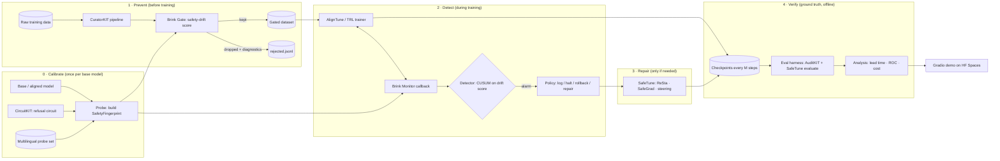

# Brink — Architecture

> Detect and prevent LLM safety collapse **during** fine-tuning, as it happens, instead of after training.

## 1. Thesis (what we must prove)

1. **Predictable:** a cheap mechanistic signal (refusal direction / refusal circuit) moves *before*
   behavioural safety metrics (HarmBench attack success rate) degrade during fine-tuning.
2. **Preventable:** the same signal, applied to training data *before* fine-tuning, identifies the
   benign-looking samples that cause drift. Removing them keeps task performance and most of the safety.
3. **Cheaper than repair:** gate + monitor beats post-hoc repair (ReSta, SafeGrad) on the
   safety / capability / compute trade-off.
4. **Multilingual (Aya angle):** drift shows up earlier or harder outside English, and Brink catches it
   where English-only evals don't.

Every component below exists to produce evidence for one of these four claims.

## 2. System overview



## 3. Components

### 3.0 `brink.probe`: the shared measurement core
Everything else depends on this, so it has to be fast, deterministic and work on a **live `nn.Module`**
(for the in-training callback) as well as a **checkpoint path** (for offline analysis).

**SafetyFingerprint** (built once from the base model, saved to the Hub):
- refusal direction `r̂_ℓ` per layer = normalized diff-in-means of last-token residuals, harmful vs harmless
  prompts (per language and pooled);
- chosen layer `ℓ*` (max separation on a held-out split; never picked automatically at runtime);
- refusal circuit components from CircuitKIT, mapped to HF module names (see §5, decision D2);
- baseline mean / std of every signal on the base model, per language.

**Signals** (computed on a fixed probe set, about 64 harmful + 64 harmless prompts per language):

| ID | Signal | Cost | What it catches |
|---|---|---|---|
| S1 | Mean projection of harmful-prompt activations on `r̂_ℓ*` | 1 forward pass | Refusal representation weakening |
| S2 | Cosine(current diff-in-means direction, base `r̂`) | same pass | Refusal direction rotating away |
| S3 | Refusal-vs-compliance first-token logit gap on harmful prompts | same pass | Behaviour about to flip, no generation needed |
| S4 | Activation / attribution mass on refusal-circuit components | hooks, same pass | Circuit being dismantled |
| S5 | Over-refusal guard: S3 on harmless prompts | same pass | Monitor not just rewarding "refuse everything" |

All five come from **one batched forward pass with hooks**, about 1–3 s on a T4 for Tiny Aya. That is
the cost story: a HarmBench run needs generation plus a 7B judge.

**Probe-set hygiene:** probe prompts are disjoint from every evaluation prompt (HarmBench, AuditKIT
red-team). Otherwise the "lead time" claim is contaminated.

### 3.1 `brink.gate`: prevention, before training
Scores each training sample by **predicted refusal erosion**: the first-order change in the monitor's own
objective J (S3 and/or S1 on the harmful probe set) caused by one SGD step on that sample:
`score(x) = cos(∇_LoRA L(x), ∇_LoRA J)`, using fresh LoRA adapters as a random projection of the full
gradient (as in LESS). The gate and the monitor therefore measure the same thing, before and during
training. Baselines: representation similarity to unsafe vs safe anchors (He et al. 2024), and random.

Policy: drop the top-k % or everything above a threshold. It is packaged as a **CuratorKIT `BaseGate`**
(`brink.gate.curatorkit_gate.BrinkSafetyGate`): rejected samples go to CuratorKIT's `rejected.jsonl`, and
provenance records carry the score and rank. Details and the experiment: [GATE.md](GATE.md).

### 3.2 `brink.monitor`: detection, during training
- A standard `transformers.TrainerCallback`, so it works under AlignTune's TRL backend, plain TRL and
  SafeTune's trainers without depending on AlignTune internals.
- Every `N` steps, on the live LoRA model (no reload): run the probe, then compute the drift score
  `D_t = Σ w_i · z_i(t)`, a z-score of each signal vs base stats, per language, worst language wins.
- **Detector:** one-sided CUSUM on `D_t`, so a single noisy step can't fire it. The threshold is
  calibrated on **negative-control runs** (safe data) to a fixed false-alarm rate (target ≤ 5 %).
- **Policies on alarm:** `log` (study mode) · `halt` · `rollback` to last safe checkpoint ·
  `repair` (hand off to `brink.repair`) · `harden` (resume with SafeGrad).
- Logs every signal to JSONL plus trackio / W&B, so the demo dashboard can replay any run.

### 3.3 `brink.repair`: acting on the alarm
Built: see [REPAIR.md](REPAIR.md).
- **In-training policies**, run by `RepairController` from the monitor's online alarm: `halt`, `rollback` to
  the last LoRA snapshot the monitor rated safe, and the **erosion guard**. The guard is gradient surgery that
  removes the component of each task gradient that would lower the monitor's objective J. It needs no
  reference model and no safety dataset.
- **Post-hoc baselines via SafeTune:** ReSta (α = 0.25 for Tiny Aya) and steering along the fingerprint's
  pre-drift refusal direction, at a strength set from the measured erosion.

The same quantity J ties the system together: the gate scores data by `cos(∇L, ∇J)`, the monitor watches J,
and the guard keeps training from lowering J.

### 3.4 `brink.eval`: ground truth, offline
Runs on dense checkpoints (every `M` steps) to build the behavioural curve the monitor is judged against.
- **Safety:** HarmBench ASR (SafeTune `evaluate`, WildGuard judge) plus AuditKIT red-team
  (jailbreak, injection, encoding), per language.
- **Over-refusal:** AuditKIT over-refusal probes. A safe-but-useless model is a failure.
- **Capability:** the fine-tuning task's own metric plus a small lm-eval subset.
- **Stats:** bootstrap CIs and significance tests via AuditKIT; 2 seeds per condition in go / no-go (sized to the GPU quota).

### 3.5 `brink.analysis`
- **Lead time:** `t_behav` = first checkpoint where ASR > base + δ (CI excludes base); `t_alarm` = first
  CUSUM alarm; `lead = t_behav − t_alarm` (steps and GPU-minutes).
- Detection ROC across positive (drift) and negative (control) runs; false-alarm rate.
- Spearman correlation of each signal vs ASR across checkpoints (the "judge-free proxy" fallback claim).
- Cost: GPU-seconds per probe vs per HarmBench eval.
- Pareto plot: safety vs capability vs compute for every condition.

### 3.6 `app/`: the product and the dashboard (Gradio, HF Spaces)
Built: see [DASHBOARD.md](DASHBOARD.md). Three tabs:
- **Run Brink** runs the whole pipeline live on a real model (`brink/live/`): fingerprint, gate a
  contaminated fine-tuning set, fine-tune unprotected vs with Brink (alarm + repair), verify both on held-out
  prompts. Tiny Aya on a GPU, a 0.5B model on CPU. `experiments/live.py` records the same run headless.
- **Gate your data** scores an uploaded fine-tuning file and returns the ranked samples and a cleaned file.
- **Experiments** reads any run folder (finished, or still being written) and
recomputes the alarm from the logs with an adjustable rule (signal, z threshold, persistence, CUSUM). It shows
status, alarm vs behaviour-break step and lead time, probe-vs-eval cost, the signal curves, the ASR ground
truth, per-layer erosion, and the gate results. Live mode follows a run as it trains, e.g. from a Kaggle
notebook with a public share link. The Experiments tab needs no ML stack; the first two tabs need the
training stack (installed on the Space). Model replies are judged but never shown or stored.

### 3.7 Integrations (built)
- **Hugging Face Trainer / TRL:** `BrinkCallback` runs the monitor on `on_step_end`, the guard on
  `on_pre_optimizer_step`, and halts via `control.should_training_stop`. Tested under `transformers.Trainer`.
- **AlignTune:** its callback adapter passes no step or control to AlignTune callbacks (see
  [UPSTREAM.md](UPSTREAM.md)), so `attach_to_aligntune` adds Brink to the HF trainer AlignTune builds.
- **AuditKIT:** red-team probes on every final model in experiment 02, reported per family. Attack
  resistance and over-refusal are kept separate.
- **Multilingual:** per-language fingerprints and a worst-language alarm (experiment 03,
  [MULTILINGUAL.md](MULTILINGUAL.md)).

## 4. Experiments

| # | Experiment | Data | Conditions | Seeds | Doc |
|---|---|---|---|---|---|
| 00 | go / no-go | harmful compliance (`pos`) vs Alpaca + refusals (`control`) | 2 | 3 | [GO_NOGO.md](GO_NOGO.md) |
| 01 | data gate | 1,950 Alpaca + 50 planted harmful; then top / random / bottom 256 benign | 3 + scoring | 1 | [GATE.md](GATE.md) |
| 02 | repair | Alpaca with 10 % harmful contamination | none, safety_mix, halt, rollback_guard, guard_always, posthoc_steer, posthoc_resta | 1 | [REPAIR.md](REPAIR.md) |
| 03 | multilingual | English `pos` / `control`; probes and evals in English, Hindi, Tagalog | 2 | 1 | [MULTILINGUAL.md](MULTILINGUAL.md) |
| 04 | pipeline | Hindi Aya instructions with 10 % contamination | naive, brink | 1 | [PIPELINE.md](PIPELINE.md) |

Model throughout: Tiny Aya (`CohereLabs/tiny-aya-global`, 3.35B). All five stages run in order with
`notebooks/kaggle_run_all.ipynb` (Kaggle) or `experiments/run_all.py` (any GPU machine).

## 5. Key design decisions

| # | Decision | Why |
|---|---|---|
| D1 | Monitor core is framework-agnostic (`monitor(model, step)`), with a thin `TrainerCallback` adapter; signals use plain PyTorch, not toolkit internals | Toolkits are young (AgentTune has 5 commits; open PRs everywhere). Brink must not break when they do. The go / no-go uses its own loop because HF Trainer would DataParallel across both Kaggle GPUs, and GPU 1 is the judge's. |
| D2 | CircuitKIT runs **offline, once**, on the base model; components are mapped to HF module names for hooking | CircuitKIT uses TransformerLens, which is too heavy for in-loop use, and Aya support is experimental. |
| D3 | **Two Python envs** if needed: `train` (AlignTune / SafeTune / CuratorKIT / AuditKIT) and `circuits` (CircuitKIT) | CircuitKIT pins transformers 5 + transformer-lens 3.8.0, and AlignTune's vendored Unsloth caps transformers. They likely conflict. |
| D4 | Core: Python ≥ 3.10 (runs on Kaggle as-is). Full Lexsi stack: **3.12** | SafeTune needs ≥ 3.12; CircuitKIT supports ≤ 3.12. |
| D5 | Layer `ℓ*` and steering α are fixed at calibration, never auto-picked | SafeTune docs: the auto layer sweep can pick a bad layer, and α is model-specific. |
| D6 | Detector threshold set on negative controls | Without controls, an always-firing monitor looks perfect. Judges will check this. |
| D7 | LoRA everywhere | Fits free GPUs, lets the callback probe the live model cheaply, and makes ReSta / rollback cheap. |

## 6. Responsible-release policy
- Publish: probe sets, fingerprints, gate code, gated datasets, **repaired / protected** adapters, all
  logs and results.
- Do **not** publish deliberately drifted checkpoints; keep them private or gated. This also respects
  SafeTune's responsible-use clause (no deploying unrepaired drifted checkpoints).
- The license for Brink's own code is still to decide. Note that the toolkits we depend on are LSAL
  (source-available, non-commercial); only AlignTune is MIT.

## 7. Risks and fallbacks

| Risk | Fallback |
|---|---|
| Tiny Aya doesn't drift enough | Raise `train.lr` to 2e-4 or `max_steps`; preflight and the go/no-go notes say so |
| No mechanistic lead time | Claim the honest version: a judge-free proxy (S3) that tracks ASR at a fraction of an eval's cost, compared with the cheap-judge baseline |
| Safe fine-tuning trips the alarm | The threshold is calibrated on control runs, and false alarms are tested leave-one-seed-out |
| fp16 overflow on T4 | `collect` raises a clear error; calibrate in float32 or use a bf16-capable GPU |
| SafeTune / AlignTune won't install on Kaggle | Preflight reports it; repair runs without post-hoc conditions; the pipeline falls back to Brink's loop and says so |
| A Kaggle session ends mid-run | Results are pushed after every stage and the run-all notebook resumes |

## 8. Repository layout

```
brink/
├── brink/                  # the library
│   ├── probe/              # fingerprint, signals S1-S5, multilingual probing
│   ├── gate/               # per-sample erosion score, CuratorKIT BaseGate
│   ├── monitor/            # monitor core, alarm rules, HF / TRL / AlignTune callback
│   ├── repair/             # policies (halt, rollback, guard), erosion guard, SafeTune post-hoc
│   ├── eval/               # behavioural ASR (WildGuard / keyword), capability, AuditKIT red-team
│   ├── analysis/           # one module per experiment: verdicts, reports, plots
│   ├── dashboard/          # run loading, live metrics, Plotly figures (no ML dependencies)
│   ├── live/               # Brink end to end in one call: config, data, status, pipeline, manager, upload
│   ├── data.py             # datasets and disjoint splits for every experiment
│   ├── runner.py           # shared plumbing: loaders, calibrated threshold, evaluator, monitored runs
│   └── train_loop.py       # LoRA SFT loop with controller hooks
├── experiments/            # entry points: preflight, go_nogo, gate, repair, multilingual, pipeline, live, run_all
├── configs/                # one YAML per experiment
├── notebooks/              # Kaggle notebooks (kaggle_run_all.ipynb runs everything)
├── app/                    # Gradio app: Run Brink, Gate your data, Experiments
├── scripts/                # Hugging Face Space build, Hub publishing
├── results/                # small CSV / JSON / Markdown / PNG outputs (large artifacts never committed)
├── tests/                  # offline CPU tests on tiny random models
└── docs/
```

## 9. Status

Everything above is built and tested offline (`make test`; CI runs it on every push). What remains is running
the experiments on GPUs and filling the results into [SUBMISSION.md](SUBMISSION.md).
